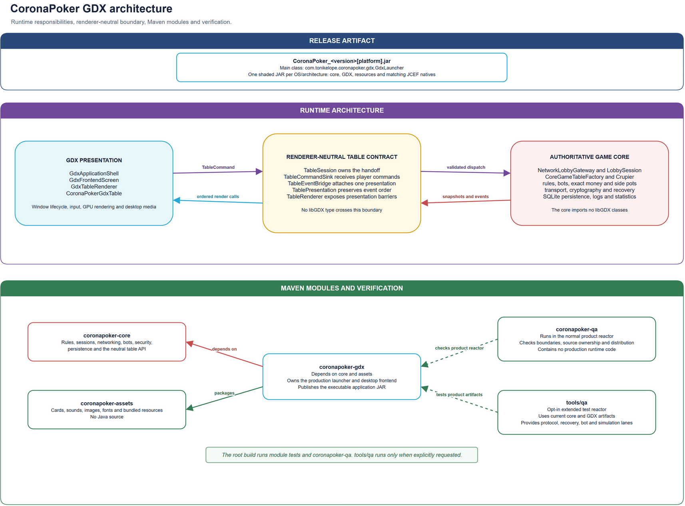
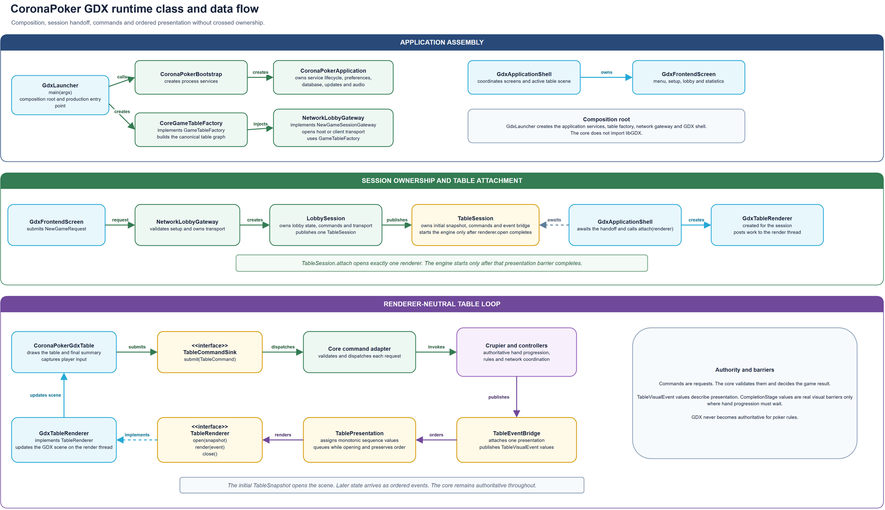

<div align="justify">

<i>Once upon a time, before ChatGPT, some humans coded for pleasure...</i>

<h1 align="center">CoronaPoker</h1>

<p align="center">
  <a href="https://github.com/tonikelope/coronapoker/graphs/commit-activity"></a>
  <a href="https://www.gnu.org/licenses/gpl-3.0"></a>
</p>

This is the project of a perfectionist who, during the COVID-19 lockdown, decided to build the most complete and enjoyable open-source Texas Hold'em game for his friends. What began as a passion project gradually evolved into something much larger: a long-term software engineering laboratory where every subsystem became an opportunity to build things the way I believed they should be built. The ambition was to create the poker game I always wanted to play and the software project I always wanted to engineer.

I hope you enjoy playing it as much as I have enjoyed building it.

**Carpe diem.**

<p align="center"><a href="https://github.com/tonikelope/coronapoker/releases/latest" target="_blank"></a></p>

<h1 align="center"><a href="https://github.com/tonikelope/coronapoker/releases/latest"><b>DOWNLOAD CORONAPOKER</b></a></h1>


## Table of contents

- [Features](#features)
  - [Security & cryptography](#-security--cryptography)
  - [Networking & resilience](#-networking--resilience)
  - [Texas Hold'em: rules & table](#-texas-holdem-rules--table)
  - [Bots](#-bots)
  - [Chat, voice & social](#-chat-voice--social)
  - [Poker videos](#-poker-videos)
  - [Statistics & history](#-statistics--history)
  - [Customization & MOD packs](#-customization--mod-packs)
  - [UX & display](#%EF%B8%8F-ux--display)
  - [Internationalization](#-internationalization)
- [Stack](#-stack)
- [Architecture](#%EF%B8%8F-architecture)
- [Build and certify from source](#build-and-certify-from-source)
- [Testing & certification](#-testing--certification)
- [Contributors](#-contributors)

# Features

## 🔐 Security & cryptography

CoronaPoker is built around one security goal: **detect or prevent cheating, spying and tampering even when the host is not trusted**.

### Zero-trust deck protocol
Every card is shuffled and locked collectively by **every human member of the hand's cryptographic ring** through a commutative Mental Poker (SRA) protocol, with a zero-knowledge **verifiable shuffle** that every ring member re-checks independently, so a malicious host cannot silently peek, duplicate or relocate a card in a completed deal. Pocket cards stay sealed end-to-end until showdown. Community cards unlock per street. **No single participant, not even the host, can learn another player's hole cards or the board before its legitimate reveal**. *(Built from scratch over Ristretto255, with DLEQ-chained dealing and a Bayer-Groth shuffle.)*

### Per-nick cryptographic identity & signed actions
Every human player carries a persistent **Ed25519 keypair** stored locally with restricted ACLs (POSIX 0600 / Windows owner-only ACL). Betting actions, community and showdown reveals, straddle decisions, Rabbit requests, seat-draw commitments and closing receipts use distinct signed domains. A **hash chain** ratchets over each hand (`H_{t+1} = SHA-256(record || sig)`), committing every peer to the exact action history, and its closing state folds in the hand's **settlement** (who put in how much and who was paid how much). Before durable close, every peer enforces exact-cent conservation (`paid + closing carry = contributed + opening carry`) and exchanges signed receipts with the currently expected human ring members. Controlled departures are excluded because they cannot sign a future close. A conservation error, divergent or missing expected receipt, or invalid-signature flag stops SQLite close and hand advancement, preserving the open state for recovery. TOFU records the first key seen for a nick. A later different key is accepted as `CHANGED`, replaces the stored key, increments the session count and clears the out-of-band verification flag. This transition never blocks admission and is always recorded. To avoid notification noise, GDX shows an additional in-window warning only when the old identity had been explicitly verified out of band. An unverified key change remains in the game/debug logs without a popup. Compare the identity identicon/fingerprint out of band whenever key continuity matters.

### End-to-end encrypted channels
Post-handshake application traffic between a client and the host is encrypted with **AES-256-CBC + HMAC-SHA256** over keys negotiated via **ECDH key exchange**. A network observer sees opaque authenticated frames rather than game state, chat or actions. The recovery payload reader installs a strict **`ObjectInputFilter` whitelist** (HashMap / String / numeric boxes only, 10 MB cap, 20-deep) so a malicious host cannot supply arbitrary Java deserialization types.

### Context-aware security response
Structural SRA failures, forged community reveals and unsafe early-cascade requests trigger immediate lockdown or MISDEAL. An invalid signed betting `ACTION` is neutralised as a deterministic synthetic fold, recorded in the hand flags and causes receipt consensus to reject the durable close. Each response is logged with its precise reason.

### Fully decentralised
Peer-hosted, with no external central game server, accounts or third-party hand log. Clients connect to the table host, which relays table traffic between the machines in the game.

> Full cryptographic spec (cascade flow, key schedule, HandStateChain seed, receipt format, recovery fossil layout) lives in **[`docs/SECURITY.md`](docs/SECURITY.md)**.

---

## 🌐 Networking & resilience

- **Explicit UPnP port mapping**: the host option always opens disabled. Enabling it checks and opens the selected TCP port immediately, reports any failure without locking the control, and keeps ownership of that exact mapping only for the current lobby. Cancelling creation, leaving the waiting room or closing the table removes it. Manual port forwarding remains available as a fallback.
- **Adjustable listening port**: defaults to 7234, configurable per game.
- **Optional password protection** for the table itself, on top of channel encryption.
- **Automatic reconnection.** The disconnected client sees **Reconnecting to the server** and the table holds its seat while it retries. The host allows 45 seconds after detecting the lost socket. The client retries for up to 80 seconds by default. A successful reconnect resumes the same session and delivers pending game commands in order.
- **Crash recovery.** Local SQLite checkpoints record actions, balances, positions and the cryptographic state needed to recover a hand. When the host declares an active peer definitively lost, it voids the affected hand, refunds committed bets and opens a recoverable table. Hand creation and settlement save the complete balance roster atomically. Recovery advances from the saved hand and its recorded outcome.
- **Player departures.** A confirmed departure removes the seat from the table. **Appearance > Animations and effects > Seat movement** controls the remaining seats' repositioning. Bets already contributed stay in the hand, and an all-in player who leaves remains eligible for the pots they contested.
- **Live hot join**: enabled by default and adjustable by the host while the table is running. A human who connects after a hand has started enters the real table as **WARMING UP**, receives the authoritative current public scene and the same ordered public events as everyone else, but gets no private cards and cannot act in that hand. The seat becomes playable at the next hand boundary. Authenticated exit and reentry are supported, and a returning identity keeps its stack while never resuming a hand it already left.
- **Recent-server history**: past table addresses are persisted and exposed through a scrollable drop-down list in the Join dialog, so any saved host and port can be selected directly.
- **Per-peer link telemetry**: host tracks round-trip latency and reconnection count per seat and broadcasts it so flaky links surface early.
- **Host-managed temporary network blocks**: repeated hostile or rejected pre-authentication attempts from one address are quarantined for a limited time. The host can inspect active blocks, their reason and remaining time from the waiting room or the in-game quick bar, then remove a block immediately if it belongs to a legitimate client. Normal per-address capacity control does not create a block by itself, so several invited players behind the same router remain supported.
- **Anti-flood chat**: 0.5-second minimum between chat messages (client-side throttle on the sender's input).

---

## 🃏 Texas Hold'em: rules & table

A rules-correct No-Limit Hold'em implementation, focused on private home games rather than tournament structures.

| Feature | Details |
|---|---|
| **Players** | 2 to 10, any mix of humans and bots |
| **ALL-IN & side pots** | Fully supported with correct pot splits |
| **Table display** | The pot can show how many players have contributed and remain eligible to win. Folded opponents can be dimmed until the next hand. Both options are enabled by default in Appearance > Table. |
| **Dead-button rule** | BB / SB / Button handled correctly when players leave |
| **Action timer** | Per-turn thinking time with on-screen countdown bar |
| **Buy-in** | Fixed (everyone starts with the same stack) or variable, where each player chooses their own when they sit down. The host sets the allowed range in big blinds and a per-table stack ceiling nobody can ever exceed. |
| **Rebuy** | Mid-game top-up scheduled for the next hand, host-toggleable. Optional per-player rebuy limit, a stack-ceiling policy (capped at the table buy-in or at the current biggest stack) and a master automatic-rebuy policy for bots. Custom bots can opt out individually and remain as spectators until the host manually rebuys them. |
| **Blinds** | Adjustable by the host live, either a manual change or scheduled escalation, with optional custom blind structures (your own saved ladders of small/big blind levels, big blind free of the 2x default) and an optional cap that stops them climbing past a chosen big blind. Money resolves to the cent and blinds move in 0.05 steps, with exact accounting even on deep-stack tables. |
| **Ante & Straddle** | Two optional extra bets, off by default and host-toggleable. **Ante**: every active player posts a small dead-money ante (equal to the small blind) into the pot before the blinds. **Straddle** is **voluntary**: right after the deal, with their cards still face down and a 10-second timer (declined by default), the under-the-gun player is asked whether to post a live 2x big blind. If they post it, it buys the option to act last preflop (the "gun" moves on to the real first-to-act). If they decline, their hand simply begins as a normal turn. Both flash chips into the pot like any bet and are flagged on the felt and in the game log. |
| **Saved game presets** | Save an entire new-table setup (initial blinds and the chosen structure, buy-in, rebuy, blind increase/cap, hand limit, ante, straddle and bot difficulty) as a named profile and reload it in one click, just like custom blind ladders. A "Default" entry restores the factory setup. Main-menu game settings provide separate persistent defaults for future tables without being overwritten by lobby or live-table changes. |
| **Pause & hot join** | Pause anytime. With live hot join enabled, new or returning authenticated players can enter a running table as WARMING UP and become active on the next hand |
| **IWTSTH** | "I Want To See That Hand"  |
| **Rabbit Hunting** | Reveal what would have come on the remaining streets, toggleable. If you also show your hole cards, hovering your displayed hand highlights the resulting Rabbit combination regardless of which action came first. |
| **Run It Twice** | On a multi-way all-in, the involved players vote to deal the remaining board twice and split each (side)pot between the two run-outs. Unanimous (a single NORMAL vote, or a vote timeout, cancels it), host-toggleable. |
| **Spectator mode** | Busted-out players can stay at the table and watch the rest of the session |
| **Hand generator** | Beginner-friendly tool: shows random example deals for each hand category (from high card up to royal flush) so newcomers learn how rankings form, with Previous/Next controls and keyboard navigation |

### 📜 Robert's Rules of Poker compliance

CoronaPoker follows **Robert's Rules of Poker**, the de-facto standard cardroom rulebook, for every rule a digital game can meaningfully enforce. The betting engine cites the specific rules right in its source (`BetRules.java`). The table below maps the implementation to the rulebook's *play* rules. (A lot of the casino-floor rules only make sense in a brick-and-mortar room and simply don't apply to a peer-to-peer digital table: rake and collection, cash on the table, physically protecting your hand, verbal-in-turn etiquette, foreign-language and waiting-list policy. On top of that, the verifiable-deck protocol already makes most of the frauds they exist to prevent impossible by construction.)

| Rule | Robert's Rules | CoronaPoker |
|---|---|---|
| **Hole cards & deal order** | §5: two hole cards, dealt one at a time starting left of the button, and the button gets the last one | ✅ |
| **Burn cards & board** | §5: burn before flop, turn and river, then a flop of 3, turn 1 and river 1. Playing the board is allowed | ✅ |
| **Button rotation** | §4: moves one seat clockwise after each hand | ✅ |
| **Dead button** | §4.2(b): BB, SB and button adjust correctly when a player leaves | ✅ |
| **Blind positions** | §4: SB first clockwise from the button, BB second. Preflop opens UTG, postflop opens the SB | ✅ |
| **Heads-up** | §4.3: the SB is *on* the button, acts first preflop and last postflop | ✅ |
| **No-Limit raising** | §14.1-3: unlimited raises, minimum bet equals the big blind, and a raise must be at least the previous bet or raise | ✅ |
| **Incomplete all-in** | §14.3: an all-in for less than a full raise does **not** reopen the betting to players who already acted | ✅ |
| **Aggregated short all-ins** | §14.4: several short all-ins that together add up to a full raise **do** reopen the betting | ✅ |
| **Straddle** | §14.15: one optional live straddle, 2x BB, immediately left of the BB, sets a new bring-in | ✅ |
| **Hand ranking & cards speak** | §3: best five of seven, kicker tie-breaks, hands read for themselves | ✅ |
| **Ties & suits** | §3 (Ties): suits never break a tie for a pot | ✅ |
| **Side pots** | §3 (Showdown 7): each player only contests the portion of the pot they contributed to | ✅ |
| **Showdown order** | §3 (Showdown 8): last aggressor shows first, and if it was checked down, first-to-act shows first | ✅ |
| **Muck losing hands** | §3 (Showdown): a beaten hand may be thrown away without showing (the *IWTSTH* toggle) | ✅ |
| **Run it twice** | §14.17: all-in players may agree to deal the board twice | ✅ |
| **Action clock** | §14.16: a time limit may be set, and on time-out the hand is dead | ⚠️ *house tweak* |
| **Odd chip** | §3 (Ties, 5a): an indivisible odd chip goes to the first player clockwise from the button | ⚠️ *house rule* |

**House-rule choices (deliberate deviations)**

- **Odd chip.** Instead of handing the indivisible cent to whoever sits next to the button, CoronaPoker carries it into a **shared carry-over pot that rolls into the next hand**. Money stays exact to the cent and no seat position ever gains from a split. I find that fairer, and it's something Robert's Rules itself sanctions under §2 (House Policies, rule 1: *"Management reserves the right to make decisions in the spirit of fairness"*). The same carry-over pot also absorbs the leftover cent from a Run It Twice board split, which the rulebook doesn't address, so it all stays a single, uniform mechanism.
- **Action timeout.** Where the rulebook always kills the hand on time-out, CoronaPoker **auto-checks when checking is free** and only auto-folds when there's a bet to call (the online-poker standard). The clock itself is fully configurable, and you can switch it off entirely.

> 📄 The full rulebook ships with the game. Read it here: **[Robert's Rules of Poker (PDF)](robert_rules.pdf)**.

---

## 🤖 Bots

These aren't the fold-everything-and-wait kind. CoronaPoker bots play like real opponents.

- **3 difficulty levels** (Easy, Medium, Hard), each clearly distinguishable within a single session
- **3 skill tiers** assigned per bot, weighted by difficulty:
  - 🍿 **Recreational**: loose, emotional, prone to tilt after losses
  - 🛠️ **Regular**: solid fundamentals, occasional mistakes
  - 🦈 **Shark**: disciplined, exploitative, calculates fold equity
- **4 adaptive personalities** that shift dynamically with stack pressure (M-ratio), tilt and table dynamics:
  - 🗿 **NIT**: tight, conservative, rarely bluffs
  - 📡 **STATION**: calls everything, impossible to read
  - 🎯 **TAG**: tight-aggressive, the textbook grinder
  - 💥 **LAG**: loose-aggressive, unpredictable and relentless
- **Host-managed custom bot profiles**: choose each bot's nickname, validated avatar, individual difficulty, real AI personality and automatic-rebuy preference. Profiles enter in the chosen or shuffled order. The host can forbid standard-bot fallback when the catalogue runs out.
- **Real poker engine** built on the Alberta hand evaluator + hand-potential (true equity, not lookup tables)
- Multi-street planning: **c-bets, polarised river & turn bluffs, semi-bluffs, slow-played traps, float plays, scare-card reads, MDF bluff-catching** and range-aware aggression, so they don't play their hand face-up
- **Per-bot opponent tracking** (VPIP / PFR / AF, calling-station & maniac reads): they remember your tendencies and *stop bluffing the player who never folds*
- **Heads-up vs multi-way awareness**: ranges and bluff frequencies are gated to the table size
- **Calibrated mistake injection** scaled by difficulty: Hard is razor-sharp, Easy makes human-shaped errors in the right spots
- **Dedicated QA**: deterministic bot integration runs with normal game QA. Statistical strength benchmarks against fixed-strategy opponents are a separate opt-in lane when bot behaviour changes

> Full bot AI write-up, covering architecture, the hand-evaluation maths, the personality model and the per-turn decision pipeline (with two diagrams), lives in **[`docs/BOTS.md`](docs/BOTS.md)**.

---

## 💬 Chat, voice & social

### Waiting room chat
Full chat while the game is being set up, with a built-in **emoji picker (~1.800 emojis with recent-use history)**, inline **GIF support** and **automatic image previews** for URLs pasted into the chat.

### In-game fast chat
Chat messages and game notices appear in a color-coded feed at the left of the table. Fast chat keeps the full session history, and messages appear as they arrive while **text-to-speech** reads them in order. The **Table** appearance settings control the feed and the speaking emoji independently.

### 🎙️ Voice messages
Walkie-talkie style, push-to-record: **hold a key (F9 by default, rebindable), speak, release to send**. The on-screen recording banner only appears once the microphone is actually capturing (when you see it, nothing you say can be lost), with a draining countdown bar (15 seconds max, auto-send at the cap). While you record, **all local game audio is silenced** so your mic picks up your voice and nothing else. The note travels to every player through the same end-to-end encrypted channel as the chat and plays automatically on arrival (music ducks under the voice, the speaker's avatar lights up), including on your own machine as send confirmation. Every note also lands in the chat history as a clickable **[Voice message]** entry. Click it (or its emoji) to replay anytime. The line turns into *[Playing...]* while it sounds, and clicking another note switches to it. Notes are kept locally under `.coronapoker/voice/` as standard WAV files. The whole feature is **host-toggleable per game** (the rule survives stop & recover) and respects per-player muting.

### 🔊 Audio settings
Right-click any speaker icon for the audio settings dialog: **master volume** (two-way synced with the global Shift + Up/Down shortcut, persisted across sessions), **output device** selection with instant hot-switching (background music jumps to the new device immediately), and **microphone** enablement, device selection and push-to-record key binding for voice messages.

### Player avatars
Each player picks a local **avatar image** (or falls back to a built-in default) that the host distributes to the rest of the table at join time. Remote PNG/JPEG/GIF avatars are rejected before rasterization when their Base64/decoded size, dimensions, frame count or total canvas work exceeds the bounded policy. Temporary files and thumbnails are owned by the room session and cleaned together. Client rosters are capped at the same ten participants as the host before any avatar allocation. Bots use a dedicated bot avatar. Avatars are decorative, not authoritative. Identity binding lives in the Ed25519 keypair (see the Security section), and a separate **identicon dialog** lets you compare deterministic mosaics out-of-band: at the table, click a player's avatar for their **Ed25519 pubkey** identicon (with a TOFU "mark verified" button to remember future connections). In the waiting room, right-click your own nick for the **session-key (AES channel)** identicon for detecting a network MITM.

### Action sounds & character voices
Distinct sounds for every action (deal, check, call, raise, fold, all-in, showdown, winner) plus comedy voice clips that can be triggered on common actions. Everything is toggleable and replaceable.

---

## 🎥 Poker videos

Watch YouTube poker videos in a floating player on the main menu or in the
waiting room. Playback starts muted, with YouTube's audio and caption
controls available. If you leave the player open, the game restores your
video session when you return from the table.

- **Carousel**. Start with regular videos by default or switch to Shorts.
  Search prioritises the game's language. The carousel shuffles each batch,
  fetches more results in the background, and skips recently seen videos.
- **Favorites**. Save both formats in one list in the order you add them.
  Browse with the arrow buttons and see your position in the list. The
  player adapts to each video's format.
- **Resizable window**. Drag or resize the player. It remembers its position
  and size separately for each format across restarts. Close it to minimise
  it to the icon next to the volume control.
- **Startup and animations**. Choose whether the player opens at startup
  and whether its window animates when opening or closing.

Configure it under **Appearance > Animations and effects > Poker videos**.
See the [poker video guide](docs/JCEF_VIDEO_EXPERIMENT.md) for the controls,
platform requirements and troubleshooting.

---

## 📊 Statistics & history

- **Offline dashboard.** Review net profit, profit per hour when session duration is recorded, hands played, and bankroll history. Explore VPIP, PFR, 3-bet, AF, WTSD and W$SD, compare players and sessions, or inspect heatmaps for positions and starting hands. The dashboard uses bundled Apache ECharts and runs offline.
- **Filters and hand history.** Choose a game, player, or session date range. Use the previous and next hand buttons to inspect recorded cards, positions, actions and showdown results in order. The **Exclude bots** checkbox removes bot results while retaining hands and results recorded for human players.
- **Classic statistics and chart controls.** The original profit, performance, response time, betting and winning hand views are available in the dashboard. Zoom the interface, resize individual charts, and restore their original sizes. The native statistics screen opens automatically if Chromium cannot load the dashboard.
- **Local SQLite history.** The database records hand timestamps, actions by street, community cards, stacks, winners and pots. The live in-game log shows the current hand as it happens.
- **Optional peer-to-peer sync.** Players at a table can exchange completed games directly. Receiving and sharing are independent and both start disabled. Mark games private or use **Exclude** to leave out games involving selected nicknames when sharing.

---

## 🎨 Customization & MOD packs

CoronaPoker discovers an external `mod` directory beside the installation and
can safely overlay the supported presentation assets:

- **Card decks**: 4 themes bundled (`coronapoker`, `interstate60`, `goliat`, `goliat4`), each in both animated GIF and static HQ variants.
- **All-in cinematics**: 9 bundled GIF sequences. A MOD can replace or combine the set and supply companion audio.
- **Sound packs**: action sounds, table music and per-language comedy categories for English and Spanish.
- **Safe fallback**: missing optional assets retain the official presentation, while unsafe paths and malformed descriptors are rejected.

> The complete authoring reference covers descriptor flags, the exact directory
> tree, card naming, sounds, cinematics and the distribution checklist. It lives in
> **[`docs/MODS.md`](docs/MODS.md)**.

---

## 🖥️ UX & display

- **One responsive GDX table layout** that scales and extends with the available window while preserving the same controls and presentation model.
- **Three display modes**: exclusive fullscreen, borderless fullscreen (the default) and windowed, with optional automatic fullscreen when a table starts.
- **Appearance controls** for the deck, card back, felt and table-light level, with live previews where applicable.
- **Graphics controls** for vertical synchronisation, frame-rate limit and overlay, MSAA and card rendering.
- **Consistent settings controls** in the main menu, waiting room and live table: categorical choices use scrollable drop-down lists, while minus/plus steppers are reserved for quantities. Live-table restrictions keep the same layout and clearly show whether an option is locked for everyone or host-only.
- **Low-brightness overlay** for late-night sessions, with a configurable light level.
- **Optional animations and effects**, with one master switch plus independent controls for halos/glows, dialog blur and highlights/bevels. Table, card and cinematic animation behaviour remains configurable.
- **Community card deal style** under Appearance > Animations and effects. **By street** is the default. The flop arrives as a covered stack, turns over in the first slot, then spreads to the right. The turn and river travel covered from the dealer and turn over after landing. The flight is slower in this mode. **All face down at the start of the hand** deals the full board at the same speed as the players' cards. A saved change takes effect from the next hand.
- **End-of-game cards** under Appearance > Animations and effects controls how the balance cards enter the final summary. The animation is on by default. Turn it off to show the cards immediately in place. The final count has its own switch.
- **Action confirmation** with an optional safety prompt before fold, all-in or raise.
- **Straddle timeout** is a personal setting under Game Settings > Blinds. By default the player declines when time runs out.
- **Auto-action buttons**: pre-arm your next move while it's not your turn: check/fold (never mucks a free check) or auto-call up to a configurable limit. Optionally keep the pre-press armed across hands, and veto each automatic action through a 5-second cancelable **AUTO MODE** dialog.
- **Rebindable keyboard shortcuts** for common table, audio, voice, screenshot and window actions, managed from the built-in controls editor.

---

## 🌍 Internationalization

- Bundled languages: **English** and **Spanish**.
- All UI strings, dialogs, action labels and contextual sounds are localised, including the comedy voice packs.

---

## 🧱 Stack

- **Java 17+** for both building and running
- **Single-version protocol**: Every participant in a game must run the exact same CoronaPoker version. The host refuses mismatched versions instead of enabling compatibility modes.
- **LibGDX** desktop UI with an LWJGL3 backend
- **Maven** multi-module build producing a self-contained application JAR per platform
  from the game core, assets and GDX frontend
- **Alberta** poker hand evaluator for true equity computation
- **SQLite** (via `sqlite-jdbc`) for local hand history
- Pure-Java **SRA / Ristretto255** implementation (RFC 9496) with DLEQ-proof verifiable dealing and a zero-knowledge **Bayer-Groth verifiable shuffle**, no native crypto dependencies

---

## 🏗️ Architecture

A high-level map of the product modules, dependencies, packaging and
certification layers:



The class-level view shows the executable entry point, application startup,
lobby and table creation, and the command and event paths across the
renderer-neutral table boundary:



The complete walkthrough, including startup sequences, source locations and
the responsibilities of `TableSession`, `TableCommandSink`,
`TableEventBridge`, `TablePresentation`, `TableRenderer`, snapshots and visual
events, is in
**[`docs/ARCHITECTURE.md`](docs/ARCHITECTURE.md)**.

Product Java sources have one physical owner. Game logic and renderer-neutral
contracts live in `modules/coronapoker-core`. Presentation and input live in
`modules/coronapoker-gdx`. Shared assets remain in `src/main/resources` and are
packaged by `modules/coronapoker-assets`. Architecture tests enforce these
ownership boundaries, prohibit GDX dependencies in the core and reject
duplicated product classes.

### Repository layout

- `pom.xml`: canonical product build entry point.
- `modules/coronapoker-core/`: shared game, networking, persistence and
  renderer-neutral presentation contracts.
- `modules/coronapoker-gdx/`: libGDX application and desktop launcher.
- `modules/coronapoker-assets/`: shared resources packaged from
  `src/main/resources`.
- `modules/coronapoker-qa/`: architecture and source-ownership tests.
- `tools/qa/`: opt-in protocol, recovery, security and headless simulation
  tests. Behavioural certification scenarios live with the GDX test sources.
- `tools/windows/` and `packaging/windows/`: reproducible Windows installer
  build and its native CoronaPoker icon.
- `docs/`: architecture, security, testing and contributor documentation.
- `target/`: generated product JAR and platform distribution artifacts.
- `coronaupdater.jar`: special root-level updater artifact required by the
  GitHub self-update mechanism.

The cryptographic subsystem, covering verifiable **SRA / Ristretto255** dealing with DLEQ proofs, the zero-knowledge **Bayer-Groth** shuffle, per-nick **Ed25519** identity, the per-hand `H_t` ratchet and the receipt consensus, has its own two diagrams (a component architecture and a full per-hand protocol sequence) embedded in **[`docs/SECURITY.md`](docs/SECURITY.md)**.

The **bot AI**, covering its architecture, hand-evaluation maths, personality model and per-turn decision pipeline, is documented in depth, with its own two diagrams (a component architecture and a decision-flow chart), in **[`docs/BOTS.md`](docs/BOTS.md)**.

The complete QA model, test lanes, seeded headless campaigns, certification
profiles and unified scenario catalogue are documented in
**[`docs/TESTING.md`](docs/TESTING.md)**.

---

## Build and certify from source

Requirements: JDK 17 or newer for both building and running, and Apache Maven
3.x. Maven compiles against the Java 17 API baseline. The checked-in `qa.cmd`
also requires Windows PowerShell. It detects and prints the Maven/JDK selected
for the run and does not install either dependency. A first build requires
access to the configured Maven repositories unless its dependency cache is
already populated. Exact environment discovery and network assumptions are
documented in [Testing and certification](docs/TESTING.md).

For an ordinary build from a clean clone, use the product reactor. It builds
the core, assets and GDX application and then packages one executable:

```bash
git clone https://github.com/tonikelope/coronapoker.git
cd coronapoker
mvn clean package
```

The only product-artifact directory is the repository-root `target/`. The build
generates this runnable JAR:

```text
target/CoronaPoker_<version>.jar
```

The application is shaded into a module-local staging JAR and published to
`target/` only after that archive is complete. This prevents a running table
from reading a partially rewritten JAR.
Each JAR selects the JCEF payload and LWJGL/libGDX native families for its own platform:
Windows x64, Linux x64/ARM64, or macOS Intel/Apple Silicon. A matching JDK 17
or newer is still required on the target
machine. On macOS the launcher transparently restarts itself on Cocoa's first
thread, so the normal `java -jar` command remains valid. In exclusive
fullscreen GLFW owns display-sleep inhibition. In windowed and borderless
modes, Windows uses its execution-state API, macOS uses an IOKit power
assertion and Linux uses the standard `systemd-inhibit` session facility when
available to prevent idle display and system suspension. No platform path
simulates keyboard or mouse input.
The root `pom.xml` is the canonical product entry point and delegates to the
module reactor.

The Windows local distribution and release asset keep the historical name
`target/CoronaPoker_<version>.jar`. Linux releases append `_Linux_x64` or
`_Linux_arm64`. macOS releases append `_macOS_x64` or `_macOS_arm64` before
`.jar`. `tools/build/build-platform-jars.ps1` creates and verifies the five
release payloads under `target/release-<version>/`. Ordinary local builds
produce the current host's JAR. The updater selects the correct platform asset
and installs it beside the running application as `CoronaPoker.jar`, then
relaunches that stable filename. No manual rename is required.

Windows releases additionally provide
`CoronaPoker_<version>_Windows_x64_Setup.exe`. This bilingual per-user
installer contains a native `CoronaPoker.exe` with the official CoronaPoker
logo and a private Java 25 runtime with all the modules of the source JDK.
Its bilingual wizard uses CoronaPoker artwork, follows the Windows theme
and shows installation size and progress. The optional MODs section can
download Chilean MOD from GitHub or install a personal ZIP from disk.
See [how to package a personal MOD](docs/MODS.md#package-a-personal-mod)
for the supported ZIP layouts and optional password protection.
Its internal stable JAR and retained private `java.exe` preserve the same
`coronaupdater.jar` self-update path used by the portable release. Build it
after the product JAR with `tools/windows/build-release-installer.ps1`. The
wrapper securely verifies and reuses its Git-ignored local JDK 25 cache. See
[`packaging/windows/README.md`](packaging/windows/README.md) for prerequisites,
layout and optional Authenticode signing.
The native launcher intentionally skips the legacy JVM splash for a more
direct startup. The portable JAR keeps its existing splash screen.

### The simple local workflow

After changing a `.java` file, use the repository-root QA command. It chooses
the Maven executable, uses the checkout-local dependency cache and stops at the
first failed layer:

```powershell
# Rebuild and leave the runnable JAR in target/, without tests.
.\qa.cmd build

# Increment the product version everywhere, then build the new JAR.
.\qa.cmd build -IncrementVersion

# Rebuild and run the product module and architecture tests.
.\qa.cmd test

# Add the slow replayable non-bot regression lane.
.\qa.cmd extended

# Run only every GDX scenario once when gameplay wiring needs certification.
.\qa.cmd scenarios fast

# Complete release gate: product tests + extended QA + deeper scenarios once.
.\qa.cmd all balanced
```

Running `.\qa.cmd` without arguments is the same as `test`. Scenarios never
start accidentally. Use `scenarios stress` or `all stress` for major protocol,
recovery or concurrency work. `quick` selects a critical subset. `fast`,
`balanced` and `stress` use the same complete catalogue and differ in internal
depth or repetitions.
Run `.\qa.cmd -Help` for focused scenario, seed replay and bot-quality options.
The detailed interpretation guide is in
[Testing and certification](docs/TESTING.md).

Use the lifecycle according to intent:

| Goal | Command |
|---|---|
| Rebuild runnable JAR without tests | `.\qa.cmd build` |
| Increment the version and rebuild the runnable JAR | `.\qa.cmd build -IncrementVersion` |
| Rebuild and run product and architecture tests | `.\qa.cmd test` |
| Add the slow replayable non-bot regression lane | `.\qa.cmd extended` |
| Run the complete scenario catalogue once | `.\qa.cmd scenarios fast` |
| Complete release gate | `.\qa.cmd all balanced` |
| Compile and run the product module tests | `mvn verify` |
| Produce a clean GDX distribution | `mvn clean package` |
| Build without tests for packaging diagnosis only | `mvn clean package -DskipTests` |
| Run the extended deterministic QA lane | `mvn -f tools/reactor/pom.xml verify` |
| Run a seeded headless protocol campaign | `.\tools\qa\headless-sim.cmd` |
| Certify the complete GDX scenario catalogue | `.\tools\qa\certify.cmd -Mode balanced` |

Only the clean full-reactor command constitutes a distribution build. Building
the GDX module directly is useful for local iteration but does not certify the
complete product.

`-IncrementVersion` is deliberately opt-in and valid only with `build`. Before
Maven starts, it reads the current two-component product version, increments
its final component through `.99` and then rolls over to the next `.0` (for
example, `25.99` becomes `26.0`, never `25.100`). It updates every canonical
Maven, runtime metadata and Java version marker, verifies that they agree, and
prints the source version, the destination version and the number of changed
files. If the subsequent build fails, the increment remains visible in the
working tree so it can be reviewed or corrected explicitly. The script never
hides a partial release attempt.

GDX gameplay certification has one catalogue and one result. `fast` and
`balanced` execute the complete catalogue once. `balanced` increases the
internal hand depth, while `stress` adds five complete passes and the deepest
internal loads. `quick` is the explicit short subset for iteration. See
[Testing and certification](docs/TESTING.md) for the exact costs and report
format.

Launch CoronaPoker:

```bash
java -jar target/CoronaPoker_<version>.jar
```

`coronaupdater.jar` is intentionally the only JAR outside `target/`: the
self-update mechanism requires that special helper at the repository root.

## 🧪 Testing & certification

The `test` command runs code and architecture tests. Extended QA,
headless campaigns and GDX behavioural certification are separate layers and
are never packaged in the game JAR. `qa.cmd` is the recommended single entry
point. The individual Maven and runner commands remain available for diagnosis.

**[Testing and certification](docs/TESTING.md)** is the canonical guide for
test groups, expected cost, dependencies, command order, scenario modes and
release gates. Contributors extending the catalogue should use
**[Adding test scenarios](docs/ADDING_TEST_SCENARIOS.md)**.

---

## 🙌 Contributors

CoronaPoker is developed by [@tonikelope](https://github.com/tonikelope), with a heartfelt thank-you to the bug reporters and testers whose detailed reports keep the project moving forward. The full list lives in **[`CONTRIBUTORS.md`](CONTRIBUTORS.md)**.
