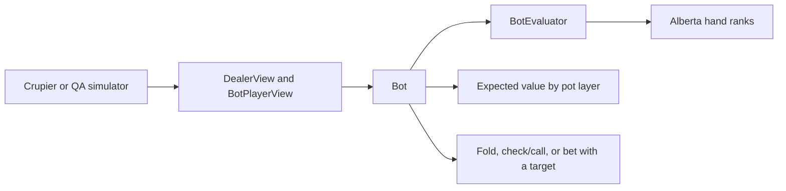
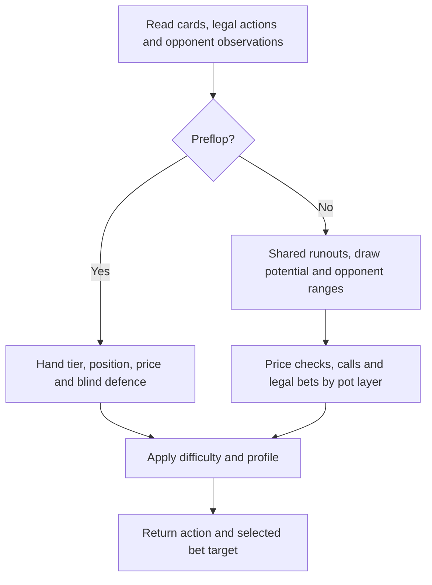
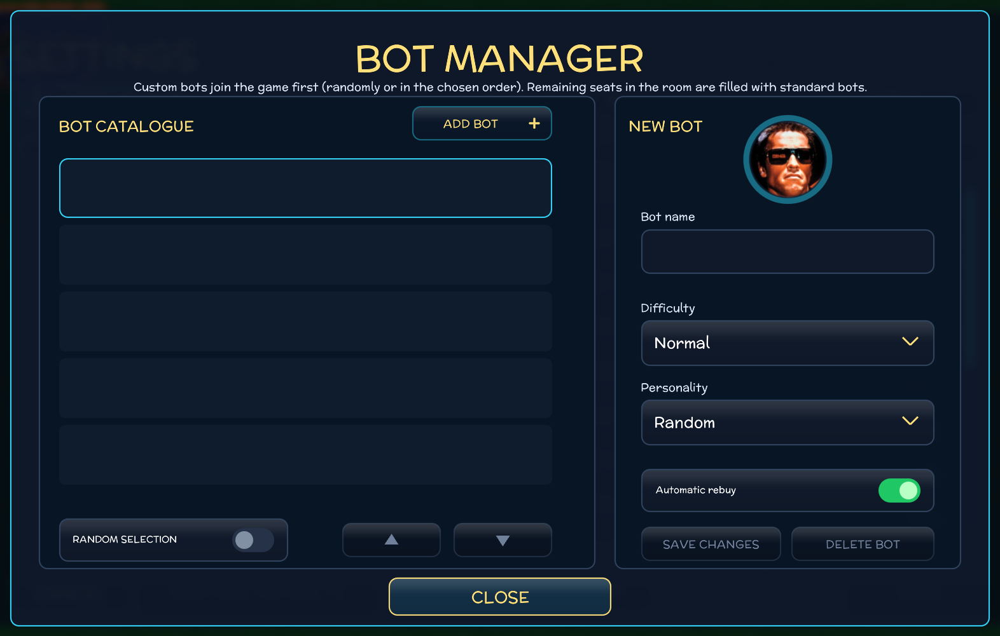

<div align="justify">

# CoronaPoker: Bot AI

This document describes how the CoronaPoker CPU players ("bots") think: their
architecture, the hand-evaluation maths, the style model, the per-turn
decision pipeline and how the three difficulty levels are kept genuinely
distinguishable. It is the bot counterpart of [`SECURITY.md`](SECURITY.md).

The implementation lives almost entirely in
[`Bot.java`](../modules/coronapoker-core/src/main/java/com/tonikelope/coronapoker/Bot.java) plus the
`bot/eval` and `bot/context` packages. The underlying combinatorics come from the
University of Alberta Poker Research Group library under `org.alberta.poker`.

---

## 1. Design philosophy

The bot combines **poker heuristics**, exact heads-up runout enumeration
against uniform hands, and opponent reads. HARD adapts its betting and
calling to the player across the table. The lower difficulties preserve
distinct styles and recognisable mistakes.

Three properties follow from that:

- **Playing style.** A table can mix selectivity, frequent calls and
  aggression at the same difficulty. The host can choose a base style for
  each custom bot.
- **A measurable difficulty gradient.** The weaker levels commit recognisable
  poker mistakes at increasing frequencies. Seeded matchups measure the
  resulting difference in bb/100 under the tested conditions (see §8).
- **Measurable calibration.** Every behavioural change is validated in an offline
  simulation harness (`tools/qa`) over thousands of hands. The rule is *measure
  before you touch*. Bot "improvements" judged by eye have repeatedly turned out
  to be regressions.

Custom bot profiles do not create a second AI engine. They configure this same
engine per seat: the host can choose an avatar, nickname, difficulty and one of
the real behavioural profiles described below.

---

## 2. Architecture



The bot subsystem is layered, and the layers are joined by deliberately narrow
**`«interface»` seams**:

- **`DealerView`**: a read-only slice of the dealer/table state the bot needs
  (street, pot, current bet, last raise, blinds, bet count, limpers, the dealer /
  SB / BB / UTG nicks, the last aggressor, players in seating order, and the
  board cards). `Crupier` implements it directly.
- **`BotPlayerView`**: a read-only slice of a player (nick, stack, current bet,
  active flag, hole cards). The full `Player` interface extends it, so any
  concrete player satisfies it for free.
- **`BotEvaluator`**: the umbrella evaluation contract
  (`HandStrengthEvaluator` + `DrawPotentialEvaluator` + `HandRankResolver`).

These seams are the **testability boundary**: because the bot only ever talks to
the table through them, the offline QA harness can inject a *fake* dealer, fake
players and a seeded RNG and run thousands of hands headless, with no UI and no
sockets. Production wires the real `Crupier`, real `Player`s and the
`MemoizedAlbertaEvaluator`.

A single `Bot` instance is attached to each CPU seat. The dealer reaches the
seat, calls `calculateBotDecision(opponents)`, and the engine returns one of
`BET`, `CHECK-CALL` or `FOLD`. When that decision is a bet or raise, its size is
computed in the **same** pass and read back separately through `getBetSize()`, so
the dealer stakes exactly the amount the EV was evaluated on (§5.3).

---

## 3. Hand evaluation

The bot reduces every situation to two numbers from the `BotEvaluator`:

- **Hand strength**: `handStrengthVsN(hole1, hole2, board, opponents)`: the
  probability the current hand is best against *N* independent random hands on the
  current board.
- **Potential**: `potential(...)` returns a **`Potential`** = `(PPot, NPot)`
  (Papp 1998 §5.3):
  - **PPot** (positive potential): probability a hand currently *behind* improves
    to best as more board cards arrive.
  - **NPot** (negative potential): probability a hand currently *ahead* falls
    behind.

On the flop and turn, the production evaluator enumerates each public runout
and counts wins and ties against every legal heads-up holding on that runout.
It averages the pot shares across runouts, so all opponents see the same
future board. The uniform model is exact for one or two opponents and counts
only disjoint hole-card pairs when two opponents are present. With three or
more opponents, it applies blocker corrections to the uniform approximation.
HARD can evaluate the ranges jointly with four or more opponents, or with
three opponents on the river. This requires informative public observations
for at least two opponents. The remaining ranges are uniform. The joint
model conditions the ranges on a legal deal, removing the bot's cards, the
board and any cards already assigned to another range. It uses one shared
runout on the flop and turn.

On the river, the three-opponent solver counts disjoint holdings exactly.
The general solver enumerates small river range products exactly and uses
deterministic importance sampling for larger products and earlier streets.
Sparse or highly concentrated samples can fall back to the simpler equity
model. Each side pot uses only its eligible opponents. The estimator splits
the pot among tied winners.

### Card encoding

Throughout the bot subsystem a card is an integer in `[0..51]`:
`index = rank + suit × 13`, with `rank` in `[0..12]` (`2..A`) and `suit` in
`[0..3]`. `Bot.coronaCard2LokiCard(...)` converts the legacy product `Card` to this
Alberta encoding.

### Two evaluators, one of them a reference

```
BotEvaluator
 ├── AlbertaEvaluatorAdapter     (reference / oracle, uncached)
 └── MemoizedAlbertaEvaluator    (production, shared-board enumeration)
```

The opponent's terminal rank depends on the union of their hole cards and the
new board cards. The evaluator ranks each set once and counts every valid
assignment. It reuses these terminal ranks across bots acting on the same
board. Draw potential retains parity with the Alberta reference.

`AlbertaEvaluatorAdapter` uses the uncached `ppot_raw` path as a reference
for uniform opponents. The weighted API uses the cached Alberta path with
a Java fallback for seven-card ranking. The uniform enumeration supplies
the base equity. HARD reweights holdings using public preflop participation
and observed checks, calls, bets and raises. When both opponents on the
river have informative ranges, it evaluates their disjoint holdings
together. Heads-up river decisions can also use the observed range.
With both hole-card pairs fixed, potential counts 990 two-card flop runouts,
45 one-card flop continuations, or 44 possible rivers from the turn.

---

## 4. Difficulty and style

The bot manager offers two AI settings.

| Setting | Values | Effect |
| --- | --- | --- |
| **Difficulty** | Easy, Normal, Hard | Selects the tactical rules and mistake rate. Easy uses recreational play, Normal uses the regular repertoire and Hard uses the advanced repertoire. |
| **Style** | Random, NIT, STATION, TAG, LAG | Sets how selectively and aggressively the bot tends to play. Every fixed style is available at each difficulty. |

Random picks the base style when the bot is created. The probabilities vary
by difficulty.

| Difficulty | NIT | STATION | TAG | LAG |
| --- | ---: | ---: | ---: | ---: |
| Easy | 7.20% | 46.60% | 29.00% | 17.20% |
| Normal | 10.25% | 16.50% | 47.50% | 25.75% |
| Hard | 5.25% | 1.75% | 56.75% | 36.25% |

The base style stays fixed across hands in the active session. Recovering a
game reconstructs the bot and can draw a different random style.

At the start of each hand, `adjustProfileElasticity` derives the current
style from the base style and the situation. A LAG on Normal or Hard can
tighten to TAG with a shorter stack, while a deep-stacked NIT can loosen to
TAG. On Easy, a losing streak can temporarily make the bot play more
aggressively.

---

## 5. The per-turn decision pipeline



`calculateBotDecision(opponents)` wraps `computeRawDecision(...)` and then applies
the mistake layer (§8). `computeRawDecision` splits on the street.

### 5.1 Preflop

`calculatePreflopAction` classifies the hole cards into one of **five tiers**
(`evaluateHandTier`: 1 = premium pairs / AK, up to 5 = trash) and then chooses an
action from **position × profile × bet level**:

- **Open / fold** by position (EARLY/MIDDLE/LATE/BLINDS) and profile, with NITs
  tighter and LAGs/late position wider.
- **3-bet / 4-bet / 5-bet** for value with premium tiers. Small pairs set-mine
  versus a 3-bet.
- **Bluffs and steals:** blocker-based 3-bet bluffs and squeezes on HARD, late
  trash steals, and (heads-up) a wide button-open / BB-defend matrix tuned by a
  per-difficulty *looseness offset* (see §8).
- **Blind steals on HARD:** an otherwise folded small blind can open when
  the big blind's observed folds make the proposed size profitable even
  assuming the bot loses its entire wager when called.
- Tiers are also nudged by table size (an early-position tier-3 tightens at a full
  ring, marginal hands loosen short-handed). Expensive marginal calls
  require better pot odds or sufficient effective stacks. Small pairs
  facing a 3-bet use a separate implied-odds check.
  Easy STATION calls marginal hands readily and can fold an expensive
  offsuit hand. Normal NIT applies a price check to marginal cold calls.

### 5.2 Postflop

The postflop branch builds the picture in stages (all cached so a betting round
does not recompute invariants):

1. **`evaluatePostflop`** caches current heads-up win and tie frequencies and
   projected pot shares for every opponent count on the public board.
2. **`PPot` / `NPot`** come from the same enumeration on the flop and turn.
   They are zero on the river.
3. **`effective strength`** includes one-pair overcard and weak-kicker
   penalties. The `0.10` floor is used for style thresholds only.
4. **Scare-card detection:** on a new street, an effective-strength drop greater
   than `0.15` flags a scare card (and can downgrade an aggressive plan).
5. **`winProb` adjustments** to the raw equity for the *context*. The whole
   block applies on Normal and Hard. Easy receives a `+0.10` adjustment
   when on tilt.
   - −0.10 when facing a postflop raise, −0.12 on a scare card (skipped for
     a LAG profile, which does not flinch at
     scare cards), −0.03 out of position.
   - opponent read (when there is enough data): −0.18 vs a nit, +0.12 vs a
     maniac, −0.03 vs a station.
6. **Expected value:** the bot prices checks, calls and legal raises using
   each pot's contributions and eligible players. It treats excess
   uncalled chips as a refund and uses the expected share for each pot.
   Safe draws can get an implied-odds bonus bounded by the effective stack
   behind. Raise outcomes use fold estimates based on bet size, board and
   opponent reads. In heads-up pots, HARD discounts its expected showdown
   share after a raise because stronger hands are more likely to call.
   When HARD faces a bet, it can weight the bettor's starting hands by their
   observed preflop participation. Late bets made into several opponents
   also receive a strength adjustment. These adjustments apply to the pots
   and outcomes that bettor can still win.
7. **Pot commitment:** at low SPR with a strong hand, the bot can call down
   when its estimated call EV is positive.

Postflop position follows the acting order of the seats still able to bet.
Flop continuation bets use the last seat to increase the preflop wager.

The result routes to one of two sub-routines:

**`decisionWhenCheckedTo`** (no bet to call): slow-play traps with monsters,
flop **C-bets** (boosted by a range advantage and dry boards, cut on wet/paired
boards and multiway), **semi-bluffs** with strong draws (the PPot threshold is
*street-aware*, lower on the turn, where only one card is to come), river **value
/ thin value / polarized bluffs**, street-plan barrels, and finally a plain
EV-driven value bet.

**`decisionWhenFacingBet`** (a bet to call): dynamic **check-raises**, **floats**
(call in position to bluff a later street), pot-committed shoves/calls, **value
raises** (HARD uses a lower value-raise threshold),
heads-up **semi-bluff raises** on HARD, **squeezes**, and otherwise a call or
fold on adjusted EV. An unbeatable river hand retains its mathematical
showdown share for the call decision. Calls use the
stack-capped cost and the bot's share of eligible pot layers.

> Postflop raises are capped at `MAX_BET_COUNT = 3` bet levels per street.
> The preflop value-raise rules have their own limits.

### 5.3 Bet sizing

`getBetSize` is **board-texture aware**: dry boards get a small (~⅓ pot) bet, wet
boards get a polarized split (large for value, a small block-bet otherwise), with
style multipliers (LAG bigger, NIT smaller) and an occasional HARD river
overbet. When facing a wager heads-up, HARD also prices the minimum legal raise.
The bot stores the selected target so the dealer uses the size evaluated in
the decision, including any conversion to an all-in.

---

## 6. Multi-street planning

On the flop the bot may commit to a **street plan** (`generateStreetPlan`) that
survives across streets instead of deciding each street in a vacuum:

| Plan | When | Behaviour |
|------|------|-----------|
| `BET-BET-BET` | a monster, a LAG value-barrel (strength in `[0.60, 0.80)`), or a LAG triple-barrel bluff | barrel every street |
| `BET-CHK-BET` | a strong-but-not-nutted hand | pot control on the turn |
| `CHK-CALL` | a trap with the nuts (slow-play / TAG) | check-call down |
| `none` | draws and marginal hands | decide street by street |

A plan is re-evaluated as streets arrive: `BET-BET-BET` is aborted on a scare card
(downgraded to pot control) or when the pot goes multiway, and `CHK-CALL` is
abandoned if the opponent overbets or a nit applies real pressure.

---

## 7. Opponent modelling

Each table keeps **`GameOpponentStats`** per nickname across hands. The
dealer records accepted actions from every seat and the bot reads the same
public observations for human and bot opponents. An all-in that only
matches an existing bet counts as a call. Folded seats still affect table
size while their hands are ineligible for pot equity.

- **VPIP** (voluntarily put money in pot), **PFR** (preflop raise) and **AF**
  (aggression factor) are the headline stats.
- Derived reads: `isStation()`, `isNit()`, `isManiac()` once there is a sample
  (>10 hands), and an **early** `looksPassiveStation()` read (≥3 post-flop calls
  with zero aggression) that fires *before* the full sample so the bot stops
  firing −EV bluffs at a fish during the first orbit.
- The reads feed both the `winProb` adjustment (§5.2) and **fold equity**.
  A calling-station read starts from a zero-fold prior. HARD updates that
  estimate if the opponent actually folds in the relevant situation.
- HARD learns separate fold frequencies for each street and for opponents
  who have already invested on that street. It also tracks first bets and
  checks, using late-street frequencies to discount marginal hands against
  selective bettors. Estimates blend observations with priors as data arrives.

---

## 8. The difficulty gradient

Three mechanisms shape the difficulty gradient:

1. **Mistake injection** (the dominant lever). After computing its decision the
   bot may, with a per-difficulty probability, replace it with a recognisable
   recreational *leak*:

   | Difficulty | Mistake rate |
   |-----------|:---:|
   | HARD   | 0%  |
   | MEDIUM | 22% |
   | EASY   | 45% |

   The leaks are a sticky calldown, a hero fold, a missed value bet and a spewy
   preflop call. All of them downgrade toward passivity or surrender (none
   *adds* a bet) so a weaker bot bleeds expected value without becoming a
   maniac. This is the "Stockfish skill-level" pattern: the same engine, more
   self-sabotage at lower levels.

2. **Tactical rules** (§4). Hard adds more selective preflop raises,
   semi-bluffs and weighted opponent ranges. Easy uses simpler decisions.

3. **Tuning knobs** that scale with difficulty: a heads-up *looseness offset*
   (`EASY +25`, `MEDIUM −16`, `HARD −52` percentage points on steal/defend
   frequencies), the **base river bluff mix** (`HARD 50%`, `MEDIUM 14%`,
   `EASY 0%`, EASY plays its river face-up), and HARD-only refinements such as a
   lower value-raise threshold.

> Note: an `EXPERT` difficulty found in a saved game is loaded as `HARD`.

---

## 9. Bluffing and "human feel"

The behaviours that make the bot hard to read, all gated so they stay +EV:

- **Polarized river bluff**: with air and genuine fold equity against a single
  foldable opponent, the bot represents its value range a balanced fraction of
  the time instead of always checking (a barrel that only ever means "I have it"
  is a transparent tell). A busted draw or a hand that has been barrelling tells
  the most credible story and bluffs a little more often. Fold equity is `0`
  against a station. The bot remembers the previous street's draw potential
  and checks whether the bet beats the EV of checking. HARD considers nut
  blockers and missed draws on wet boards, accounts for a check before its
  turn to act, and prices a fifth-pot bet when its planned bet costs too much.
- **Street-aware semi-bluffs**: strong draws bet for fold equity + improvement.
  The PPot threshold is lower on the turn (one card to come) so the turn is not
  played face-up.
- **Preflop 3-bet bluffs and squeezes** with blocker hands.
- **Floats**: calling in position on the flop when the price leaves enough
  expected value for a possible turn bluff. The bot discounts the projected
  gain, compares it with the available flop actions and checks the price
  and action again on the turn.
- **Reading the calling station**: the single biggest "human" fix: the bot
  detects a non-folder (even early, via `looksPassiveStation()`) and switches from
  bluffing to thin value-betting, exactly as a thinking player would.

---

## 10. Determinism, RNG and timing

- All randomness flows through a single injectable `Random` (`setRng`). Production
  uses the shared CSPRNG. The harness seeds it so a session is **bit-for-bit
  reproducible**.
- The bot is **not** thread-safe and does not need to be: bot decisions are
  evaluated **sequentially** (one seat at a time) on the dealer thread. The
  shared evaluator and trackers rely on that contract.
- The dealer enforces a **minimum** think time (**`BOT_THINK_TIME` = 1500 ms**) so a
  bot never acts instantly. It evaluates the decision synchronously on the dealer
  thread first, then sleeps only the remainder (`BOT_THINK_TIME - elapsed`). A slow
  evaluation eats into that pad instead of adding to it, and an evaluation longer
  than 1500 ms leaves no pause at all.

---

## 11. Testing and calibration

Bot quality is a *measured* property. The offline harness lives in
[`tools/qa`](../tools/qa), is built with the current product sources through
the opt-in QA reactor, and is documented in
[`tools/qa/.../bot/harness/README.md`](../tools/qa/src/test/java/com/tonikelope/coronapoker/bot/harness/README.md).

- **Matchup simulations** pit one difficulty/archetype against five others over
  thousands of hands and report **bb/100** with a *t*-statistic, plus VPIP/PFR and
  legibility metrics (post-flop bluff %, river bluff %, value/bluff split).
- **The difficulty matchups are gates:** each measured advantage must clear its
  margin and statistical threshold at the configured table size and volume.
- **The evaluator equivalence gate** (`MemoizedHandPotentialTest`) asserts the
  production evaluator's PPot/NPot are identical to the Alberta reference to
  `1e-9` over 200 seeded turns, 40 seeded flops and seven explicit comparisons.
  Separate regressions check known straight-flush rankings and turn equity
  against terminal showdown enumeration.
- **Determinism, recovery fidelity and full-table invariants** have their own
  smoke tests.

The QA module runs in **tagged lanes** (JUnit 5 `@Tag`, selected by a Maven
profile in `tools/qa/pom.xml`): `qa-fast` runs deterministic tests,
`qa-heavy` runs the non-bot slow lanes, and `qa-all` combines the fast and
slow non-bot lanes.
Bot decision, pot, evaluator and simulator regressions run in `qa-fast`,
`qa-all`, `qa-headless-all` and `qa-bots`. The statistical campaigns run
in the opt-in bot lane. Run the extended table-size and profile gates with
`qa-bot-quality`.

```sh
mvn -f tools/reactor/pom.xml verify -P qa-bots
mvn -f tools/reactor/pom.xml verify -P qa-bot-quality
```

The offline betting rounds use the table's raise reducer and settle side pots
with `CoreGamePot`. A street that exhausts its action limit fails the test.
PFR counts any player who raised preflop. The final preflop aggressor is tracked
separately for continuation-bet statistics. A seeded regression also plays an
uneven-stack session until the first bust or the end of the sample.

The statistical matchups reset stacks each hand at controlled depths.
The difficulty checks require a minimum observed margin and evidence of an
advantage over zero. Fixed-strategy matchups report session-level uncertainty.
The fixed TAG has regression floors of `-35 bb/100` heads-up and
`-30 bb/100` at a six-handed table that alternates between 40 and 100 BB.
Mixed fields shuffle five fixed opponents across seats with stacks from
30 to 160 BB. Those gates require a positive edge supported by session
results.

The other QA profiles and their intended use are defined in
[Testing and certification](TESTING.md).

Scale the iteration volume with `-Dqa.sessions=N -Dqa.hands=N`. The default
validation volume is **10,000 hands per matchup** (200 sessions × 50 hands).

> Hard-won rule: a finding that is *technically* a bug is not necessarily worth
> "fixing". The loose, fixed-strength preflop calls that make EASY/MEDIUM feel
> like fish are the *engine* of their character. Tightening them measured worse
> even though it looked cleaner. Always measure the product, not the code.

---

## 12. Source map

| Area | File(s) |
|------|---------|
| Decision engine | [`Bot.java`](../modules/coronapoker-core/src/main/java/com/tonikelope/coronapoker/Bot.java) |
| Evaluation contracts | `bot/eval/BotEvaluator.java`, `HandStrengthEvaluator.java`, `DrawPotentialEvaluator.java`, `HandRankResolver.java`, `Potential.java` |
| Evaluators | `bot/eval/AlbertaEvaluatorAdapter.java` (reference), `MemoizedAlbertaEvaluator.java` + `MemoizedHandPotential.java` (production) |
| Weighted opponent ranges | `OpponentRangeModel.java`, `ThreeSeatShowdown.java`, `MultiwayRangeShowdown.java` |
| Table/player contracts | `bot/context/DealerView.java`, `BotPlayerView.java` |
| Combinatorial core | `org.alberta.poker.*` (`HandPotential`, `HandEvaluator`, `Deck`, `Hand`, `Card`) |
| QA harness | [`tools/qa`](../tools/qa) |

---

## 13. Custom bot profiles

The host can enable **Use custom bots** on the Bots page of the game settings
and open **Manage custom bots**.



Each ordered profile stores the following settings.

- a display nickname
- the official bot avatar or a validated custom image
- an individual Easy, Normal or Hard difficulty
- a playing style chosen from Random, NIT, STATION, TAG and LAG
- an individual automatic-rebuy preference.

Difficulty determines the tactics available to the bot. Style sets the
base tendencies or lets Random choose them when the bot is created. Both
choices allow the per-hand adjustments described in
[Difficulty and style](#4-difficulty-and-style).

When custom bots are enabled, profiles enter the lobby in manager order by
default. The persistent **Random selection** switch shuffles the catalogue once
when a new lobby is created. Each configured profile can still enter at most
once, the chosen order stays stable for that lobby, and recovery keeps the
identities already stored by the game. If the host adds more bots than there
are custom profiles, the remaining seats use the standard sequential
`CoronaBot` identities. **Allow only custom bots** prevents that fallback and
stops adding bots when the catalogue is exhausted. A removed custom bot becomes
eligible again.

**Automatic rebuy** on the Bots settings page is the master control for every
bot. Standard bots rebuy while that control is enabled. A custom bot also needs
its own saved automatic-rebuy preference enabled. If either requirement is not
met, the busted bot remains at the table as a spectator instead of being
removed. The host can still open that bot's stack dialog and request a manual
rebuy. This preserves a seat for the same identity without silently changing
the saved automatic policy.

The main-menu **Games** settings page stores the defaults used to initialise a
future New Game dialog. The waiting room and live-table **Current Game** page
edits only that table. Creating, hosting or changing a live table never writes
those values back into the main-menu defaults, and saved New Game presets remain
independent.

The manager accepts the visible name without a dollar sign and appends the
reserved `$` bot marker automatically. The marker remains part of the protocol
identity because existing engine and recovery paths use it to distinguish bots.
It is never trusted as a network-security credential. Human nicknames continue
to reject `$`.

Selected avatars pass the same bounded image validation used for player
avatars, are copied into CoronaPoker-owned durable storage, and travel through
the existing lobby avatar channel. The catalogue is host-local and lives in the
normal preferences, not in a MOD pack or in authoritative game state.

</div>
