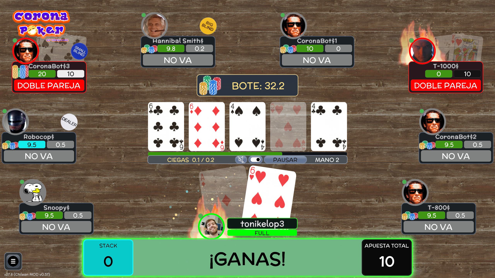

<div align="justify">

# CoronaPoker MOD packs

CoronaPoker loads one external MOD from a `mod` directory beside the game JAR.
For the portable edition, put it next to the downloaded JAR. Windows Setup
uses `app/CoronaPoker.jar`, so its MOD lives in `app/mod`. CoronaPoker looks
for `mod/mod.xml` and rebuilds its media catalog at startup. A ZIP is a
distribution format that must be extracted before the game can load it.

MOD media is decorative. It cannot replace rules, network messages,
cryptographic receipts, the shuffled deck or any other authoritative state.



The Chilean MOD changes the look and sound of the table. This example shows
its character avatars and card artwork during a showdown.

---

## 1. The three media contracts

CoronaPoker does not treat every MOD file in the same way. Each supported path
belongs to one of these contracts:

| Contract | How it works | Examples |
| --- | --- | --- |
| Exact replacement | Keep the exact relative path and filename. The MOD file is used and the official file is the fallback. | `sounds/misc/call.wav`, `cinematics/misc/game_over.gif` |
| Category bank | The directory name is fixed, but the filenames inside it are free. The bank is official, MOD-only or fused according to the catalog rules below. | `sounds/joke/es/winner/*.wav`, `cinematics/allin/*.gif` |
| Selectable addition | Every immediate subdirectory becomes a new selectable item. | `decks/mydeck/` |

Files placed at undocumented paths are not loaded merely because they exist.

### Empty starter template

The repository includes an
[`examples/mod-template`](../examples/mod-template/) skeleton with a ready to
edit `mod.xml` and every supported media branch. Copy its contents into the
installation's `mod` directory, remove the branches you do not need and add
your media. The `.gitkeep` files exist only so Git can preserve empty folders.

---

## 2. Minimal descriptor

```xml
<?xml version="1.0" encoding="UTF-8"?>
<mod adults="false" fusion_sounds="false" fusion_cinematics="false">
  <name>My CoronaPoker MOD</name>
  <version>1.0</version>
</mod>
```

- `adults="true"` shows the one-time adult-content acknowledgement.
- `fusion_sounds` controls the language-specific joke-sound banks. It does not
  affect exact replacements under `sounds/misc`.
- `fusion_cinematics` controls the all-in GIF catalog and its companion audio.
  It does not affect exact replacements under `cinematics/misc`.
- Optional `<updateurl>` and `<updatepassword>` values describe a MOD update
  endpoint. Only `http` and `https` URLs are accepted.
- `<name>` and `<version>` form the MOD name shown by the game.

Malformed XML, unreadable media and normalized paths outside the MOD directory
are rejected. A `<font>` value may be parsed for compatibility with old packs,
but the current GDX interface does not replace its fonts from that field.

---

## 3. Directory layout

```text
mod/
├─ mod.xml
├─ mod.png
├─ decks/
│  └─ mydeck/
│     ├─ hq/
│     │  ├─ 2_C.jpg ... A_T.jpg
│     │  └─ trasera.jpg
│     └─ gif/
│        └─ shuffle.gif
├─ sounds/
│  ├─ misc/
│  │  ├─ call.wav
│  │  └─ background_music.mp3
│  ├─ decks/
│  │  └─ mydeck/
│  │     └─ A_C.wav
│  └─ joke/
│     ├─ es/
│     │  ├─ allin/*.wav
│     │  ├─ fold/*.wav
│     │  ├─ showdown/*.wav
│     │  ├─ loser/*.wav
│     │  └─ winner/*.wav
│     └─ en/...
└─ cinematics/
   ├─ allin/
   │  ├─ example.gif
   │  └─ example.wav
   └─ misc/
      └─ game_over.gif
```

`mod.png` is the optional image shown with the active MOD information.

### Package a personal MOD

Create one standard ZIP. Put `mod.xml` and its resource folders at the
archive root, or put all of them inside a single top-level `mod/` folder.

```text
At the root           In a top-level mod folder
my-mod.zip            my-mod.zip
├── mod.xml           └── mod/
└── sounds/               ├── mod.xml
                          └── sounds/
```

Keep each resource in its original location relative to `mod.xml`. Windows
Setup supports both layouts, with optional password protection using WinZip
AES or ZipCrypto. It asks for a password only if it detects encrypted ZIP
entries. Use a single-volume ZIP without ZIP64 or an extra enclosing folder
such as `my-mod/mod/`. For a portable installation, extract the contents
so `mod/mod.xml` sits beside the game JAR.

---

## 4. Exact sound and music replacements

Files under `mod/sounds` shadow official resources with the same relative path.
The filename is part of the contract. For example:

```text
mod/sounds/misc/call.wav
```

replaces:

```text
sounds/misc/call.wav
```

Changing `call.wav` to another filename does not create a new call slot.

### Music slots

| Relative path under `mod/sounds` | Use |
| --- | --- |
| `misc/background_music.mp3` | Table music |
| `misc/waiting_room.mp3` | Waiting-room music |
| `misc/about_music.mp3` | About screen music |
| `misc/stats_music.mp3` | Statistics music |
| `misc/bots_manager.mp3` | Bot manager music |
| `misc/recovering.mp3` | Game-recovery music |

### User-facing effect slots

The following exact WAV names are wired to game or interface events:

```text
allin.wav              balance_count.wav      bet.wav
button_off.wav         button_on.wav           call.wav
card_visor.wav         cash_register.wav       check.wav
danger_alert.wav       deal.wav                double_blinds.wav
fold.wav               game_over.wav           hurryup.wav
init.wav               laser.wav               last_hand_off.wav
last_hand_on.wav       mat.wav                 network_error_en.wav
network_error_es.wav   new_user.wav            nocontinue.wav
pause.wav              rebuy.wav               screenshot.wav
showyourcards.wav      shuffle.wav             startplay.wav
timeout.wav            toilet.wav              uncover.wav
volume_change.wav      warning.wav             yahoo.wav
yourturn.wav           zoom_in.wav             zoom_out.wav
zoom_reset.wav
```

These optional comedy-event slots also use exact filenames under
`mod/sounds/misc`:

```text
badbeat.wav    indivisible.wav    lastcard.wav
iwtsth.wav     norebuy.wav        raise.wav
youarelucky.wav
```

Other official files requested through the same central resolver can also be
shadowed by keeping their exact `sounds/...` relative path. The settings screen
marks a setting with `(MOD)` only when the active MOD really supplies media for
that setting. It does not mark every setting merely because a MOD is installed.

---

## 5. Language-specific joke-sound banks

Joke sounds are directory banks, not exact-name replacements. The supported
categories are:

```text
sounds/joke/<language>/allin/
sounds/joke/<language>/fold/
sounds/joke/<language>/showdown/
sounds/joke/<language>/loser/
sounds/joke/<language>/winner/
```

The language and category directory names are fixed. Every readable `.wav`
directly inside the category is accepted. Its filename is free. Subdirectories
inside a category are not scanned. Files are sorted by filename so their order
is deterministic between launches.

The rule is evaluated independently for every category in the active language:

| MOD category | `fusion_sounds` | Effective bank |
| --- | --- | --- |
| Empty or absent | `false` or `true` | Official bank |
| Contains at least one WAV | `false` | MOD WAV files only |
| Contains at least one WAV | `true` | Official WAV files followed by MOD WAV files |

Therefore, creating `mod/sounds/joke/es/allin/` and adding WAV files does add
them to the official all-in sounds only when `fusion_sounds="true"`. With
`false`, that Spanish all-in category uses only the MOD files. An external
Spanish category never changes the English category.

The Joke Sounds settings page reports the effective state at the top:

```text
Sounds from MOD <name and version> are in use (exclusive mode)
```

or:

```text
Sounds from MOD <name and version> are in use (fusion mode)
```

The message appears only when at least one joke bank for the active language
contains MOD WAV files. Each category tooltip states its exact directory and
whether that category is official, exclusive or fused. Individual MOD files
use the turquoise `(MOD)` indicator.

### The three different all-in audio channels

They are intentionally independent:

1. `sounds/misc/allin.wav` is the exact action effect played for an all-in.
2. `sounds/joke/<language>/allin/*.wav` is the optional joke-sound bank.
3. `cinematics/allin/<name>.wav` is optional companion audio for
   `cinematics/allin/<name>.gif`.

Replacing one channel does not replace or disable the other two. Their own
settings decide whether each channel may play.

---

## 6. Cinematics

### All-in catalog

Put all-in animations directly in `mod/cinematics/allin` as GIF files. Their
filenames are free and sorted deterministically. A WAV with the same base name
is that GIF's optional companion audio:

```text
cinematics/allin/example.gif
cinematics/allin/example.wav
```

`fusion_cinematics` has these semantics when a MOD is active:

| Value | Effective all-in catalog |
| --- | --- |
| `false` | MOD GIF files only. An empty MOD folder produces no all-in GIF catalog. |
| `true` | MOD GIF files followed by the official GIF files. |

In fusion mode, official companion audio remains available for official GIFs.
In exclusive mode, only companion WAV files present in the MOD are available.

The official all-in GIF filenames are:

```text
casinoroyale.gif   hulk.gif            joker.gif
nicolas_cage.gif  nicolas_cage2.gif   rounders.gif
terminator2.gif   training_day.gif    wallstreet.gif
```

### Exact auxiliary cinematics

Auxiliary cinematics use exact replacement paths under
`mod/cinematics/misc`. Currently wired GIF slots include:

```text
game_over.gif
game_over_zero.gif
recover.gif
recover_es.gif
recover_en.gif
```

If a localized recovery GIF is absent, CoronaPoker falls back to
`recover.gif`, then to the official resource.

---

## 7. Card decks

Every immediate directory under `mod/decks` becomes a selectable deck. No
descriptor entry is required.

Card faces use `<rank>_<suit>.jpg`, with ranks `2` through `10`, `J`, `Q`, `K`,
`A` and CoronaPoker suit codes `C`, `D`, `P`, `T`. Put the high-quality set and
`trasera.jpg` in `hq/`:

```text
mod/decks/mydeck/hq/A_C.jpg
mod/decks/mydeck/hq/trasera.jpg
```

The renderer also accepts the same images directly in the deck directory as a
fallback. `gif/shuffle.gif` supplies the deck shuffle animation. If it is
absent, the official Goliat shuffle is used. Optional card-specific sounds use
the exact code under `mod/sounds/decks/<deck>/`, for example `A_C.wav`.

The table and hand generator use the same selected deck and the same `hq`
assets. A selected external deck is displayed with the turquoise `(MOD)`
indicator.

---

## 8. Reload, safety and troubleshooting

- Restart CoronaPoker after changing `mod.xml` or adding, removing or replacing
  MOD files. Catalogs and long-lived audio streams are created at startup.
- Test both Spanish and English when supplying language-specific banks.
- For an exact replacement, verify the complete relative path and filename.
- For a category bank, verify the fixed language and category directories. The
  WAV or GIF filename inside the final directory may be freely chosen.
- If `(MOD)` is absent from one setting, that MOD is not currently supplying
  media for that setting. This can be correct when another category is modded.
- `fusion_sounds` affects only joke banks. It never merges or renames exact
  `sounds/misc` slots.
- `fusion_cinematics` affects only the all-in GIF catalog and its companion
  audio. It never merges exact `cinematics/misc` replacements.
- Check the [ZIP layouts](#package-a-personal-mod) before distributing a MOD.

</div>
