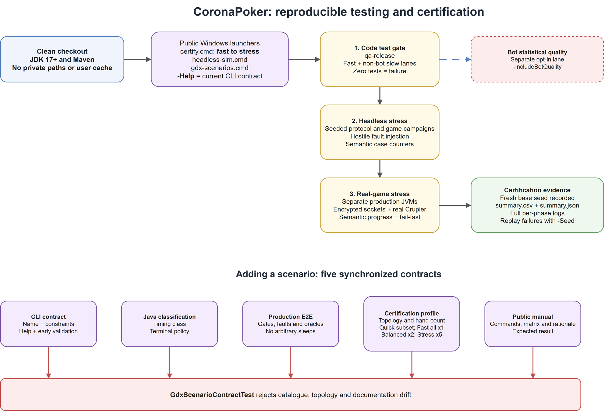

# Testing and certification

CoronaPoker separates code verification from gameplay certification. Use this
page to choose and run a check. Use [Adding test scenarios](ADDING_TEST_SCENARIOS.md)
only when extending the scenario catalogue.

## Start here

Run commands from the repository root.

| Goal | Command | What it runs |
|---|---|---|
| Build a runnable JAR without tests | `.\qa.cmd build` | Clean product package with tests skipped |
| Run the normal code gate | `.\qa.cmd test` | Clean product build plus product and architecture tests |
| Add every replayable non-bot QA test | `.\qa.cmd extended` | `test`, then the slow extended `qa-all` lane |
| Check the critical gameplay subset | `.\qa.cmd scenarios quick` | Selected GDX scenarios once with short internal loads |
| Run the complete gameplay catalogue once | `.\qa.cmd scenarios fast` | Every mapped GDX scenario method once with short internal loads |
| Run the normal release gate | `.\qa.cmd all balanced` | Product tests, extended QA and every scenario once with deeper internal loads |
| Run the deepest behavioural gate | `.\qa.cmd all stress` | Product tests, extended QA and five complete scenario passes |
| Show the executable scenario catalogue | `.\qa.cmd list` | Names and exact mapped JUnit methods, without compiling or running them |

Running `.\qa.cmd` without arguments is identical to `.\qa.cmd test`.
Scenarios never start implicitly. `build` deliberately skips tests and is not a
verified build.

Useful focused commands:

```powershell
# Rebuild and run the normal code gate.
.\qa.cmd test

# Run one scenario key and every test method mapped to it.
.\qa.cmd scenarios fast -Scenario spectator-rebuy-cycle

# Replay that selection from a recorded base seed.
.\qa.cmd scenarios fast -Scenario spectator-rebuy-cycle -Seed 42

# Add the separate statistical bot-quality lane.
.\qa.cmd extended -IncludeBots

# Show all public options without running anything.
.\qa.cmd -Help
```



## Requirements and generated state

- Windows with `powershell.exe`. The checked-in `.cmd` launchers use Windows
  PowerShell with `-NoProfile` and a process-local execution-policy bypass.
- JDK 17 or newer and Maven 3 or newer. A JRE is insufficient.
- Network access on the first build unless the ignored checkout-local
  `.m2/repository` cache already contains every dependency.
- Permission to start child JVMs and bind loopback ports for scenarios.
- Writable `.m2` and `target` directories with enough free space for the fat
  JAR, test homes, reports and logs.

The public runners search for `mvnw.cmd`, Maven on `PATH`, and then the standard
Apache NetBeans Maven installation. They print the selected Maven and Java
versions before starting work. Maven still honours its normal `settings.xml`
for mirrors, proxies and credentials.

Tests do not depend on the user's game configuration, MOD, database or language.
Temporary game homes stay below ignored build output.

## What `qa.cmd` runs

`qa.cmd` is the recommended entry point. It validates arguments, uses the
checkout-local Maven cache, stops at the first failed stage, preserves the exit
code and writes a central summary.

| Action | Product build and tests | Extended non-bot QA | GDX scenarios | Runnable JAR |
|---|---:|---:|---:|---:|
| `build` | Build only, tests skipped | No | No | Yes |
| `test` | Yes | No | No | Yes |
| `extended` | Yes | Yes | No | Yes |
| `scenarios <mode>` | Scenario clean compilation only | No | Yes | No new distribution build |
| `all <mode>` | Yes | Yes | Yes | Yes |
| `list` | No | No | Catalogue only | No |

`test`, `extended` and `all` clean-build and install the current product
modules. The extended stage then runs `tools/qa` with profile `qa-all`, so it
cannot silently test an older locally installed CoronaPoker artifact.

`scenarios` and `all` delegate to the same certifier. Before the schedule, the
certifier clean-compiles the GDX scenario reactor with tests skipped. It then
starts every mapped test method in its own Maven process and fresh JVM.
Both actions default to `balanced` when no mode is supplied. The lower-level
`certify.cmd` entry point has the same default.

The central result is written to
`target/qa/<timestamp>-<action>[-<mode>]/summary.txt` and `summary.json`.
Detailed scenario evidence is stored separately below `target/certification/`.
The `zero-trust-consensus` and `zero-trust-fatal-routes` categories form the
fatal-security matrix: receipt divergence (including admitted and warming hot
join), pre-settlement cryptographic abort, local security lockdown and
authenticated next-hand boundary rejection. These scenarios validate alert
ordering, explicit acknowledgement, process liveness before acknowledgement,
evidence parity across SQLite/file/debug, final `FAILURE` classification and
the phase-specific open/closed SQL hand state.

The process-loss matrix is deliberately bidirectional. `abrupt-exit` proves
that the authoritative host can recover from definitive client loss, while
`host-abrupt-exit` kills the host JVM during both active play and a warming hot
join. Every surviving client must receive one terminal table failure, agree on
the last conserved ledger and close as `FAILURE`; a dead authority can never
leave a renderer or dealer waiting indefinitely.

### Versioned local builds

`.\qa.cmd build -IncrementVersion` increments the two-component version before
building. The right component is bounded at 99, so `25.99` becomes `26.0`.
The option is accepted only by `build`. If compilation fails, the version edits
remain visible for explicit review.

## The four validation layers

| Layer | Proves | Public entry point |
|---|---|---|
| Product tests | Rules, networking, storage, security, GDX contracts and architecture | `.\qa.cmd test` |
| Extended QA | Large replayable regressions kept outside the product reactor | `.\qa.cmd extended` |
| Headless campaigns | Seeded high-volume protocol, fault and domain simulations | `.\tools\qa\headless-sim.cmd` |
| GDX certification | Complete game behaviour, including real sockets and separate processes where required | `.\qa.cmd scenarios <mode>` |

The layers are complementary. Headless campaigns do not run a complete GDX
table lifecycle. Scenario certification does not silently run product or
extended tests. Use `all` when one command should compose those three stages.

## GDX scenario certification

`GdxScenarioContract.CERTIFICATION_SCENARIOS` is the only executable catalogue.
`tools/qa/run-certification.ps1` reads that Java map and controls execution
policy only. There is no separate Swing, fast, balanced or stress catalogue.

The easiest entry point is:

```powershell
.\qa.cmd scenarios balanced
```

The lower-level entry point exposes schedule overrides and continuation:

```powershell
.\tools\qa\certify.cmd -Mode balanced
```

### Mode defaults

| Mode | Catalogue | Complete passes | Normal soak hands | Heads-up hands | Full mixed hands | Full human hands | Intended use |
|---|---|---:|---:|---:|---:|---:|---|
| `quick` | Critical subset | 1 | 5 | 5 | 1 | 1 | Short behavioural iteration |
| `fast` | Complete | 1 | 5 | 5 | 1 | 1 | Complete breadth with minimum depth |
| `balanced` | Complete | 1 | 20 | 20 | 3 | 1 | Normal release certification |
| `stress` | Complete | 5 | 50 | 50 | 10 | 3 | Scheduling, recovery, concurrency and adversarial work |

A **complete pass** is one outer execution of every scheduled mapped test
method. `stress` repeats that complete schedule five times. `fast` and
`balanced` both execute it once.

The four hand-depth columns are not extra catalogue repetitions. They are
budgets consumed only by scenario methods that implement those topologies:

- `Normal soak` controls the long normal-table soak.
- `Heads-up` controls the normal two-player topology.
- `Full mixed` controls the full table with humans and bots.
- `Full human` controls the full-human topology.

Most scenario methods ignore those properties and run their own fixed semantic
flow. Therefore `balanced` is deeper than `fast` without rerunning all mapped
methods a second time. `quick` is the only mode that filters the catalogue.
Supplying `-Scenario` explicitly selects that key even in `quick`.
A targeted key still inherits the selected mode's pass count and relevant
depths, so `-Mode stress -Scenario normal` repeats its mapped methods five times.

### Scenario and schedule options

| Option | Accepted by | Meaning |
|---|---|---|
| `-Scenario <name>` | `qa.cmd`, `certify.cmd` | Select one scenario key and every method mapped to it |
| `-Seed <long>` | Both | Reuse the base seed instead of generating one |
| `-RandomConditionHands <1..1000>` | Both | Initial budget for chance-gated scenarios |
| `-IndeterminateRetries <0..10>` | Both | Retries that double the chance-gated budget |
| `-VerboseScenarios` | `qa.cmd` | Stream scenario Maven output while retaining logs |
| `-VerboseOutput` | `certify.cmd` | Lower-level spelling of the same behaviour |
| `-ScenarioRepeats <1..10>` | `certify.cmd` only | Override the number of complete schedule passes |
| `-SoakHands <5..1000>` | `certify.cmd` only | Override only the normal-soak hand budget |
| `-StartAtScenario <name>` | `certify.cmd` only | Continue the complete schedule at the first method of that key |
| `-StartAtRepeat <1..10>` | `certify.cmd` only | Select the outer pass used with `-StartAtScenario` |
| `-ListOnly` | `certify.cmd` only | Print the catalogue selected by `-Mode` and `-Scenario` |

`qa.cmd list` always prints the complete catalogue. By contrast,
`certify.cmd -Mode quick -ListOnly` prints only the quick subset.

Examples:

```powershell
# One scenario key, including every method registered under it.
.\tools\qa\certify.cmd -Mode fast -Scenario spectator-rebuy-cycle

# One complete balanced pass with a known base seed.
.\tools\qa\certify.cmd -Mode balanced -Seed 42

# Deliberately repeat the balanced schedule twice.
.\tools\qa\certify.cmd -Mode balanced -ScenarioRepeats 2 -Seed 42

# Increase only the normal-soak scenario to 80 hands.
.\tools\qa\certify.cmd -Mode balanced -SoakHands 80 -Seed 42
```

### Seeds and replay

When no seed is supplied, the runner generates and prints a fresh base seed.
Each scheduled method receives a deterministic derived seed. The report stores
both values.

The seed controls cards, seating, bot choices, automated straddles, recovery
seating and observable cinematic selection. Keys, proofs, nonces, IVs and other
security entropy remain cryptographically random and may differ on replay.
They do not change the functional scenario path.

On failure, first replay the same scenario key with the recorded base seed:

```powershell
.\qa.cmd scenarios fast -Scenario spectator-rebuy-cycle -Seed 42
```

### Continuing an interrupted schedule

Continuation is available only through `certify.cmd`, only for the complete
catalogue, and cannot be combined with `-Scenario`. Reuse the original mode,
base seed, `-ScenarioRepeats` and every explicit depth override. The seed is
mandatory. For example, to continue stress pass three at
`reconnect-every-street`:

```powershell
.\tools\qa\certify.cmd -Mode stress `
  -StartAtScenario reconnect-every-street -StartAtRepeat 3 -Seed 42
```

Continuation starts at the first mapped method for that scenario key. If an
earlier method under the same key had already passed, it runs again. Derived
seeds keep their original full-schedule ordinals.

A continuation report is not a standalone certificate. Keep it with the
preceding partial report. Restart the complete required mode after changes to
shared protocol, scheduling, seed derivation or harness semantics.

### Chance-gated scenarios

Some checks require a legitimate random state before they can assert a result.
Exhausting that initial hand budget is `INDETERMINATE`, not a functional defect.

The default initial budget is 20 hands and the default retry count is 2. Every
retry restarts the same deterministic sequence with twice the previous budget.
A later success is `PASS` but reports its `IndeterminateAttempts`. Final
exhaustion stops certification as `INDETERMINATE`.

```powershell
.\qa.cmd scenarios fast -Scenario iwtsth -Seed 42 `
  -RandomConditionHands 80 -IndeterminateRetries 3
```

## Product and extended tests

The normal product gate is:

```powershell
mvn clean verify
```

It covers `coronapoker-core`, `coronapoker-gdx` and the architecture module.
Tests tagged `certification` are excluded and run only through the scenario
certifier.

Focused product test:

```powershell
mvn -f modules/pom.xml -pl coronapoker-gdx -am test `
  '-Dtest=GdxScenarioContractTest' `
  '-Dsurefire.failIfNoSpecifiedTests=false'
```

Extended QA is opt-in. The recommended direct reactor commands are:

```powershell
# Product gate plus fast deterministic extended QA.
mvn -f tools/reactor/pom.xml verify

# Fast and slow replayable non-bot QA.
mvn -f tools/reactor/pom.xml verify -P qa-all

# Slow non-bot tests only.
mvn -f tools/reactor/pom.xml verify -P qa-heavy

# Focused cryptographic or real-socket slow lanes.
mvn -f tools/reactor/pom.xml verify -P qa-crypto
mvn -f tools/reactor/pom.xml verify -P qa-network

# Statistical bot quality only.
mvn -f tools/reactor/pom.xml verify -P qa-bots

# Seeded protocol simulations or the broad non-visual integrity lane.
mvn -f tools/reactor/pom.xml verify -P qa-protocol-sim
mvn -f tools/reactor/pom.xml verify -P qa-headless-all
```

| Profile | Selection |
|---|---|
| default or `qa-fast` | Deterministic tests not tagged `slow` |
| `qa-heavy` | Slow non-bot tests |
| `qa-crypto` | Slow cryptographic tests only |
| `qa-network` | Slow real-socket stall integration only |
| `qa-protocol-sim` | Seeded protocol and lifecycle campaigns |
| `qa-headless-all` | All non-visual integrity checks except bot quality and the environment-specific ACL smoke |
| `qa-all` | Fast and slow replayable QA except bot quality |
| `qa-bots` | Statistical bot matchups, hand-potential sampling and bot game-flow smoke |

The focused profiles overlap with the aggregate lanes. Do not run `qa-fast`
immediately before `qa-all` unless the duplicated work is intentional.
`qa-bots` remains separate because it measures playing strength statistically
and can consume substantially more CPU.

## Headless campaigns

The headless runner exercises production protocol and domain components at
configurable volume without a complete GDX table:

```powershell
.\tools\qa\headless-sim.cmd `
  -Hands 5000 -Faults 5000 -BotHands 100 -Seed 42
```

`-AllNonVisual` selects every automated non-visual integrity check except bot
quality and the environment-specific ACL smoke. By default the runner builds
the current product first. `-SkipGameBuild` is safe only when compatible current
artifacts are already installed in the checkout-local Maven cache.

Use `.\tools\qa\headless-sim.cmd -Help` for exact ranges and defaults.

## Choosing the right gate

| Change | Minimum useful validation |
|---|---|
| Local calculation, codec or parser | Focused regression, then `.\qa.cmd test` |
| GDX layout or cosmetic presentation | Focused contract tests plus manual visual review |
| Shared rules or table lifecycle | `.\qa.cmd extended`, affected scenario, then `balanced` when release-bound |
| Socket, reconnect, crash or recovery | Extended QA plus affected multiprocess scenario, then `balanced` |
| Crypto or signed protocol | Product gate, `qa-crypto`, headless campaign and affected scenarios |
| Race, watchdog or scheduling semantics | Exact failing seed, complete `fast`, then fresh-seed `stress` |
| Bot decision quality | Product gate plus `qa-bots` |
| Documentation only | Link, formatting and documentation contract checks |
| Normal release | `.\qa.cmd all balanced` |

Automation proves rules, conservation, protocol agreement, persistence,
recovery, command and event wiring, and socket or process lifecycle. It does not
certify subjective rendering quality, exact pixels, physical audio devices,
real Internet or NAT behaviour, or every operating-system display setup.

## Reading results

Every public runner returns zero only when all requested work passes.
`qa.cmd` and the certifier stop on the first failed stage or scenario method.

For Maven, trust test totals, `BUILD SUCCESS` or `BUILD FAILURE`, and the process
exit code. Integration tests intentionally emit extensive informational logs.
Negative tests can also emit warnings while successfully proving rejection.

The certifier prints its mode, base seed, scheduled method count, complete-pass
count and internal depths. Each result resembles:

```text
[12/<scheduled>] r1 scenario-name -> package.TestClass#method
  PASS (12.345 s)
```

Detailed rows and logs are written to
`target/certification/<timestamp>-<mode>/summary.csv`, `summary.json` and
per-method log files. Preserve those files and the base seed for diagnosis.

When a restricted Windows sandbox causes many unrelated tests to fail with
`AccessDeniedException` while creating temporary preferences or identities,
rerun the unchanged command in a normal approved PowerShell environment. Do not
classify a genuine isolated failure as environmental without evidence.

## Cleanup

- `.m2/repository` is the ignored checkout-local dependency cache.
- Module `target` directories contain compiled classes and Surefire reports.
- Root `target` contains the runnable JAR and central QA reports.
- `tools/qa/target` contains extended QA output and isolated test homes.

Use `mvn clean` for product output and
`mvn -f tools/reactor/pom.xml clean` for extended QA output. Do not remove
reports while a build, certification run or game process is using them.

## Extending the scenario catalogue

Do not infer the authoring workflow from the runner. The separate
[Adding test scenarios](ADDING_TEST_SCENARIOS.md) guide explains layer choice,
semantic gates, registration, process isolation, replay and the definition of
done.
